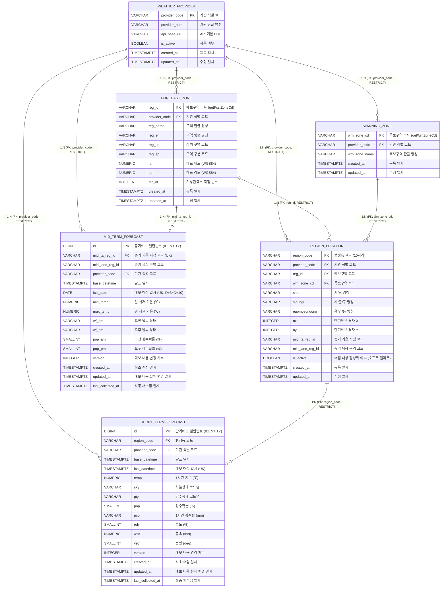

[KMA_DATABASE_DESIGN.md](../TP_BATCH_KMA/TP_BATCH_KMA/KMA_DATABASE_DESIGN.md)# 🗄️ 기상청 날씨 예보 데이터베이스 스키마 설계서 (PostgreSQL 표준 규격)

본 문서는 **기상청(KMA) API 허브** 및 향후 확장 가능한 기상 제공기관의 **단기예보**, **중기예보**, **예보구역(`getFcstZoneCd`)**, **특보구역(`getWrnZoneCd`)** 데이터를 주기적(스케줄링/배치)으로 수집하여 **항상 최신 예보로 자동 갱신(Upsert)**하고, 변경 이력 및 재수집 시점을 정밀하게 추적할 수 있도록 설계된 **PostgreSQL 공식 표준 및 권장 규격(Best Practices)** 데이터베이스 모델입니다.

---

## 📌 1. PostgreSQL 표준 아키텍처 및 ER 다이어그램



---

## 📋 2. 테이블별 상세 명세 (PostgreSQL 표준 타입 적용)

### 1) `weather_provider` (기관 마스터)

| 물리 컬럼명 | 논리 컬럼명 (한글명) | 데이터 타입 | Null 허용 | 기본값 | 제약조건 / 설명 |
| :--- | :--- | :--- | :---: | :---: | :--- |
| `provider_code` | **기관 코드** | VARCHAR(20) | NO | - | **PK** (`pk_weather_provider`) |
| `provider_name` | **기관 한글명** | VARCHAR(50) | NO | - | 기관명 (예: `기상청`) |
| `api_base_url` | **API 기본 URL** | VARCHAR(255) | YES | - | 기본 API 엔드포인트 URL |
| `is_active` | **사용 여부** | BOOLEAN | NO | TRUE | 활성화 여부 |
| `created_at` | **등록 일시** | TIMESTAMPTZ | NO | CURRENT_TIMESTAMP | 최초 등록 일시 |
| `updated_at` | **수정 일시** | TIMESTAMPTZ | NO | CURRENT_TIMESTAMP | 최종 수정 일시 |

---

### 2) `forecast_zone` (기상청 예보구역 마스터 - `getFcstZoneCd`)

| 물리 컬럼명 | 논리 컬럼명 (한글명) | 데이터 타입 | Null 허용 | 제약조건 / 설명 |
| :--- | :--- | :--- | :---: | :--- |
| `reg_id` | **예보구역 코드** | VARCHAR(20) | NO | **PK** (`pk_forecast_zone`, 예: `11B10101`) |
| `provider_code` | **기관 코드** | VARCHAR(20) | NO | **FK** ➡️ `weather_provider.provider_code` |
| `reg_name` | **구역 한글명** | VARCHAR(50) | NO | 구역 한글 명칭 (예: `서울`, `백령도`) |
| `reg_en` | **구역 영문명** | VARCHAR(100) | YES | 구역 영문 명칭 (예: `Seoul`, `Baengnyeongdo`) |
| `reg_up` | **상위 구역 코드** | VARCHAR(20) | YES | 상위 구역 코드 (예: `11A00100`) |
| `reg_sp` | **구역 구분 코드** | VARCHAR(10) | YES | 구역 구분 (A: 전국, B: 광역, C: 시군 등) |
| `lat` | **대표 위도** | NUMERIC(10, 7) | YES | 대표 위도 (예: `37.966099`) |
| `lon` | **대표 경도** | NUMERIC(10, 7) | YES | 대표 경도 (예: `124.630447`) |
| `stn_id` | **기상관측소 지점 번호** | INTEGER | YES | 기상관측소 지점 번호 (예: `108`, `102`) |
| `created_at` | **등록 일시** | TIMESTAMPTZ | NO | 최초 등록 일시 |
| `updated_at` | **수정 일시** | TIMESTAMPTZ | NO | 최종 수정 일시 |

---

### 3) `warning_zone` (기상청 특보구역 마스터 - `getWrnZoneCd`)

| 물리 컬럼명 | 논리 컬럼명 (한글명) | 데이터 타입 | Null 허용 | 제약조건 / 설명 |
| :--- | :--- | :--- | :---: | :--- |
| `wrn_zone_cd` | **특보구역 코드** | VARCHAR(20) | NO | **PK** (`pk_warning_zone`, 예: `L1020100`) |
| `provider_code` | **기관 코드** | VARCHAR(20) | NO | **FK** ➡️ `weather_provider.provider_code` |
| `wrn_zone_name` | **특보구역 한글명** | VARCHAR(50) | NO | 특보구역 명칭 (예: `서울동북권`) |
| `created_at` | **등록 일시** | TIMESTAMPTZ | NO | 최초 등록 일시 |
| `updated_at` | **수정 일시** | TIMESTAMPTZ | NO | 최종 수정 일시 |

---

### 4) `region_location` (행정동 지역 마스터)

| 물리 컬럼명 | 논리 컬럼명 (한글명) | 데이터 타입 | Null 허용 | 기본값 | 제약조건 / 설명 |
| :--- | :--- | :--- | :---: | :---: | :--- |
| `region_code` | **행정동 코드** | VARCHAR(10) | NO | - | **PK** (`pk_region_location`, 10자리) |
| `provider_code` | **기관 코드** | VARCHAR(20) | NO | `KMA` | **FK** ➡️ `weather_provider.provider_code` |
| `reg_id` | **예보구역 코드** | VARCHAR(20) | YES | - | **FK** ➡️ `forecast_zone.reg_id` |
| `wrn_zone_cd` | **특보구역 코드** | VARCHAR(20) | YES | - | **FK** ➡️ `warning_zone.wrn_zone_cd` |
| `sido` | **시/도 명칭** | VARCHAR(50) | NO | - | 시/도 (예: `서울특별시`) |
| `sigungu` | **시/군/구 명칭** | VARCHAR(50) | YES | - | 시/군/구 (예: `종로구`) |
| `eupmyeondong` | **읍/면/동 명칭** | VARCHAR(50) | YES | - | 읍/면/동 (예: `청운동`) |
| `nx` | **단기예보 격자 X 좌표** | INTEGER | NO | - | 단기예보 격자 X 좌표 (예: `60`) |
| `ny` | **단기예보 격자 Y 좌표** | INTEGER | NO | - | 단기예보 격자 Y 좌표 (예: `127`) |
| `mid_ta_reg_id` | **중기 기온 지점 코드** | VARCHAR(20) | NO | - | 중기 기온 지점 코드 (예: `11B10101`) |
| `mid_land_reg_id` | **중기 육상 구역 코드** | VARCHAR(20) | NO | - | 중기 육상 구역 코드 (예: `11B00000`) |
| `is_active` | **수집 대상 활성화 여부** | BOOLEAN | NO | TRUE | 소프트 딜리트용 플래그 |
| `created_at` | **등록 일시** | TIMESTAMPTZ | NO | CURRENT_TIMESTAMP | 최초 등록 일시 |
| `updated_at` | **수정 일시** | TIMESTAMPTZ | NO | CURRENT_TIMESTAMP | 최종 수정 일시 |

---

### 5) `short_term_forecast` (단기예보 테이블 - 최신 갱신형)

| 물리 컬럼명 | 논리 컬럼명 (한글명) | 데이터 타입 | Null 허용 | 제약조건 / 설명 |
| :--- | :--- | :--- | :---: | :--- |
| `id` | **단기예보 일련번호** | BIGINT | NO | **PK** (`GENERATED ALWAYS AS IDENTITY`) |
| `region_code` | **행정동 코드** | VARCHAR(10) | NO | **FK** ➡️ `region_location.region_code` |
| `provider_code` | **기관 코드** | VARCHAR(20) | NO | **FK** ➡️ `weather_provider.provider_code` |
| `base_datetime` | **발표 일시** | TIMESTAMPTZ | NO | 발표 시각 (최신 발표 시각으로 갱신) |
| `fcst_datetime` | **예보 대상 일시** | TIMESTAMPTZ | NO | **UK** (`uk_short_term_forecast_target` 구성요소) |
| `temp` | **1시간 기온** | NUMERIC(4, 1) | YES | 기온 (TMP, ℃) |
| `sky` | **하늘상태 코드명** | VARCHAR(20) | YES | 하늘상태 (`CLEAR`, `CLOUDY`, `OVERCAST`) |
| `pty` | **강수형태 코드명** | VARCHAR(20) | YES | 강수형태 (`NONE`, `RAIN`, `SNOW` 등) |
| `pop` | **강수확률** | SMALLINT | YES | 강수확률 (%, `CHECK (pop BETWEEN 0 AND 100)`) |
| `pcp` | **1시간 강수량** | VARCHAR(20) | YES | 1시간 강수량 (mm) |
| `reh` | **습도** | SMALLINT | YES | 습도 (%, `CHECK (reh BETWEEN 0 AND 100)`) |
| `wsd` | **풍속** | NUMERIC(4, 1) | YES | 풍속 (m/s) |
| `vec` | **풍향** | SMALLINT | YES | 풍향 (deg, `CHECK (vec BETWEEN 0 AND 360)`) |
| `version` | **예보 내용 변경 차수** | INTEGER | NO | 기본값: 1 (`CHECK (version >= 1)`) |
| `created_at` | **최초 수집 일시** | TIMESTAMPTZ | NO | 최초 수집/생성 일시 |
| `updated_at` | **예보 내용 실제 변경 일시** | TIMESTAMPTZ | NO | 실제 수치 변경 시에만 갱신 |
| `last_collected_at` | **최종 재수집 일시** | TIMESTAMPTZ | NO | 스케줄 실행 시 항상 갱신 |

---

### 6) `mid_term_forecast` (중기예보 테이블 - 최신 갱신형)

| 물리 컬럼명 | 논리 컬럼명 (한글명) | 데이터 타입 | Null 허용 | 제약조건 / 설명 |
| :--- | :--- | :--- | :---: | :--- |
| `id` | **중기예보 일련번호** | BIGINT | NO | **PK** (`GENERATED ALWAYS AS IDENTITY`) |
| `mid_ta_reg_id` | **중기 기온 지점 코드** | VARCHAR(20) | NO | **FK** ➡️ `forecast_zone.reg_id`, **UK** 구성요소 |
| `mid_land_reg_id` | **중기 육상 구역 코드** | VARCHAR(20) | NO | 중기 육상 구역 코드 (예: `11B00000`) |
| `provider_code` | **기관 코드** | VARCHAR(20) | NO | **FK** ➡️ `weather_provider.provider_code` |
| `base_datetime` | **발표 일시** | TIMESTAMPTZ | NO | 발표 시각 (최신 발표 시각으로 갱신) |
| `fcst_date` | **예보 대상 일자** | DATE | NO | **UK** (`uk_mid_term_forecast_target` 구성요소, D+3~D+10) |
| `min_temp` | **일 최저 기온** | NUMERIC(4, 1) | YES | 일 최저기온 (℃) |
| `max_temp` | **일 최고 기온** | NUMERIC(4, 1) | YES | 일 최고기온 (℃) |
| `wf_am` | **오전 날씨 상태** | VARCHAR(50) | YES | 오전 날씨 문구 (맑음, 흐리고 비 등) |
| `wf_pm` | **오후 날씨 상태** | VARCHAR(50) | YES | 오후 날씨 문구 (맑음, 구름많음 등) |
| `pop_am` | **오전 강수확률** | SMALLINT | YES | 오전 강수확률 (%, `CHECK (pop_am BETWEEN 0 AND 100)`) |
| `pop_pm` | **오후 강수확률** | SMALLINT | YES | 오후 강수확률 (%, `CHECK (pop_pm BETWEEN 0 AND 100)`) |
| `version` | **예보 내용 변경 차수** | INTEGER | NO | 기본값: 1 (`CHECK (version >= 1)`) |
| `created_at` | **최초 수집 일시** | TIMESTAMPTZ | NO | 최초 수집/생성 일시 |
| `updated_at` | **예보 내용 실제 변경 일시** | TIMESTAMPTZ | NO | 실제 수치 변경 시에만 갱신 |
| `last_collected_at` | **최종 재수집 일시** | TIMESTAMPTZ | NO | 스케줄 실행 시 항상 갱신 |

---

## 🛠️ 3. PostgreSQL 표준 DDL 쿼리 스크립트

```sql
-- ===================================================================
-- 1. 기관 마스터 테이블 (weather_provider)
-- ===================================================================
CREATE TABLE IF NOT EXISTS weather_provider (
    provider_code VARCHAR(20) NOT NULL,
    provider_name VARCHAR(50) NOT NULL,
    api_base_url  VARCHAR(255),
    is_active     BOOLEAN NOT NULL DEFAULT TRUE,
    created_at    TIMESTAMPTZ NOT NULL DEFAULT CURRENT_TIMESTAMP,
    updated_at    TIMESTAMPTZ NOT NULL DEFAULT CURRENT_TIMESTAMP,
    CONSTRAINT pk_weather_provider PRIMARY KEY (provider_code)
);

COMMENT ON TABLE weather_provider IS '기상 데이터 제공기관 마스터';
COMMENT ON COLUMN weather_provider.provider_code IS '기관 식별 코드 (PK, 예: KMA)';
COMMENT ON COLUMN weather_provider.provider_name IS '기관 한글 명칭';
COMMENT ON COLUMN weather_provider.api_base_url IS 'API 기본 엔드포인트 URL';
COMMENT ON COLUMN weather_provider.is_active IS '사용 여부 (TRUE: 활성, FALSE: 비활성)';
COMMENT ON COLUMN weather_provider.created_at IS '최초 등록 일시';
COMMENT ON COLUMN weather_provider.updated_at IS '최종 수정 일시';

INSERT INTO weather_provider (provider_code, provider_name, api_base_url, is_active)
VALUES ('KMA', '기상청 API 허브', 'https://apihub.kma.go.kr', TRUE)
ON CONFLICT (provider_code) DO NOTHING;


-- ===================================================================
-- 2. 예보구역 마스터 테이블 (forecast_zone) - getFcstZoneCd 연동
-- ===================================================================
CREATE TABLE IF NOT EXISTS forecast_zone (
    reg_id        VARCHAR(20) NOT NULL,
    provider_code VARCHAR(20) NOT NULL,
    reg_name      VARCHAR(50) NOT NULL,
    reg_en        VARCHAR(100),
    reg_up        VARCHAR(20),
    reg_sp        VARCHAR(10),
    lat           NUMERIC(10, 7),
    lon           NUMERIC(10, 7),
    stn_id        INTEGER,
    created_at    TIMESTAMPTZ NOT NULL DEFAULT CURRENT_TIMESTAMP,
    updated_at    TIMESTAMPTZ NOT NULL DEFAULT CURRENT_TIMESTAMP,
    CONSTRAINT pk_forecast_zone PRIMARY KEY (reg_id),
    CONSTRAINT fk_forecast_zone_provider FOREIGN KEY (provider_code)
        REFERENCES weather_provider (provider_code) ON DELETE RESTRICT
);

COMMENT ON TABLE forecast_zone IS '기상청 공식 예보구역 마스터';
COMMENT ON COLUMN forecast_zone.reg_id IS '예보구역 코드 (PK, 예: 11B10101)';
COMMENT ON COLUMN forecast_zone.provider_code IS '기관 식별 코드 (FK)';
COMMENT ON COLUMN forecast_zone.reg_name IS '구역 한글 명칭 (예: 서울, 백령도)';
COMMENT ON COLUMN forecast_zone.reg_en IS '구역 영문 명칭 (예: Seoul, Baengnyeongdo)';
COMMENT ON COLUMN forecast_zone.reg_up IS '상위 구역 코드 (예: 11A00100)';
COMMENT ON COLUMN forecast_zone.reg_sp IS '구역 구분 코드 (A: 전국, B: 광역, C: 시군 등)';
COMMENT ON COLUMN forecast_zone.lat IS '대표 위도 (WGS84)';
COMMENT ON COLUMN forecast_zone.lon IS '대표 경도 (WGS84)';
COMMENT ON COLUMN forecast_zone.stn_id IS '기상관측소 지점 번호 (예: 108)';
COMMENT ON COLUMN forecast_zone.created_at IS '최초 등록 일시';
COMMENT ON COLUMN forecast_zone.updated_at IS '최종 수정 일시';

CREATE INDEX IF NOT EXISTS idx_forecast_zone_provider_code ON forecast_zone (provider_code);


-- ===================================================================
-- 3. 특보구역 마스터 테이블 (warning_zone) - getWrnZoneCd 연동
-- ===================================================================
CREATE TABLE IF NOT EXISTS warning_zone (
    wrn_zone_cd   VARCHAR(20) NOT NULL,
    provider_code VARCHAR(20) NOT NULL,
    wrn_zone_name VARCHAR(50) NOT NULL,
    created_at    TIMESTAMPTZ NOT NULL DEFAULT CURRENT_TIMESTAMP,
    updated_at    TIMESTAMPTZ NOT NULL DEFAULT CURRENT_TIMESTAMP,
    CONSTRAINT pk_warning_zone PRIMARY KEY (wrn_zone_cd),
    CONSTRAINT fk_warning_zone_provider FOREIGN KEY (provider_code)
        REFERENCES weather_provider (provider_code) ON DELETE RESTRICT
);

COMMENT ON TABLE warning_zone IS '기상청 공식 특보구역 마스터';
COMMENT ON COLUMN warning_zone.wrn_zone_cd IS '특보구역 코드 (PK, 예: L1020100)';
COMMENT ON COLUMN warning_zone.provider_code IS '기관 식별 코드 (FK)';
COMMENT ON COLUMN warning_zone.wrn_zone_name IS '특보구역 한글 명칭 (예: 서울동북권)';
COMMENT ON COLUMN warning_zone.created_at IS '최초 등록 일시';
COMMENT ON COLUMN warning_zone.updated_at IS '최종 수정 일시';

CREATE INDEX IF NOT EXISTS idx_warning_zone_provider_code ON warning_zone (provider_code);


-- ===================================================================
-- 4. 행정동 지역 마스터 테이블 (region_location)
-- ===================================================================
CREATE TABLE IF NOT EXISTS region_location (
    region_code     VARCHAR(10) NOT NULL,
    provider_code   VARCHAR(20) NOT NULL,
    reg_id          VARCHAR(20),
    wrn_zone_cd     VARCHAR(20),
    sido            VARCHAR(50) NOT NULL,
    sigungu         VARCHAR(50),
    eupmyeondong    VARCHAR(50),
    nx              INTEGER NOT NULL,
    ny              INTEGER NOT NULL,
    mid_ta_reg_id   VARCHAR(20) NOT NULL,
    mid_land_reg_id VARCHAR(20) NOT NULL,
    is_active       BOOLEAN NOT NULL DEFAULT TRUE,
    created_at      TIMESTAMPTZ NOT NULL DEFAULT CURRENT_TIMESTAMP,
    updated_at      TIMESTAMPTZ NOT NULL DEFAULT CURRENT_TIMESTAMP,
    CONSTRAINT pk_region_location PRIMARY KEY (region_code),
    CONSTRAINT fk_region_location_provider FOREIGN KEY (provider_code)
        REFERENCES weather_provider (provider_code) ON DELETE RESTRICT,
    CONSTRAINT fk_region_location_forecast_zone FOREIGN KEY (reg_id)
        REFERENCES forecast_zone (reg_id) ON DELETE RESTRICT,
    CONSTRAINT fk_region_location_warning_zone FOREIGN KEY (wrn_zone_cd)
        REFERENCES warning_zone (wrn_zone_cd) ON DELETE RESTRICT
);

COMMENT ON TABLE region_location IS '행정동(읍면동) 지역 마스터 테이블';
COMMENT ON COLUMN region_location.region_code IS '행정동/법정동 10자리 코드 (PK)';
COMMENT ON COLUMN region_location.provider_code IS '기관 식별 코드 (FK)';
COMMENT ON COLUMN region_location.reg_id IS '예보구역 코드 (FK)';
COMMENT ON COLUMN region_location.wrn_zone_cd IS '특보구역 코드 (FK)';
COMMENT ON COLUMN region_location.sido IS '시/도 명칭 (예: 서울특별시)';
COMMENT ON COLUMN region_location.sigungu IS '시/군/구 명칭 (예: 종로구)';
COMMENT ON COLUMN region_location.eupmyeondong IS '읍/면/동 명칭 (예: 청운동)';
COMMENT ON COLUMN region_location.nx IS '단기예보 격자 X 좌표 (예: 60)';
COMMENT ON COLUMN region_location.ny IS '단기예보 격자 Y 좌표 (예: 127)';
COMMENT ON COLUMN region_location.mid_ta_reg_id IS '중기 기온 지점 코드 (예: 11B10101)';
COMMENT ON COLUMN region_location.mid_land_reg_id IS '중기 육상 구역 코드 (예: 11B00000)';
COMMENT ON COLUMN region_location.is_active IS '수집 대상 활성화 여부 (소프트 딜리트)';
COMMENT ON COLUMN region_location.created_at IS '최초 등록 일시';
COMMENT ON COLUMN region_location.updated_at IS '최종 수정 일시';

CREATE INDEX IF NOT EXISTS idx_region_location_grid ON region_location (nx, ny);
CREATE INDEX IF NOT EXISTS idx_region_location_mid_ta ON region_location (mid_ta_reg_id);
CREATE INDEX IF NOT EXISTS idx_region_location_active ON region_location (is_active) WHERE is_active = TRUE;


-- ===================================================================
-- 5. 단기예보 테이블 (short_term_forecast) - 최신 갱신형
-- ===================================================================
CREATE TABLE IF NOT EXISTS short_term_forecast (
    id                BIGINT GENERATED ALWAYS AS IDENTITY,
    region_code       VARCHAR(10) NOT NULL,
    provider_code     VARCHAR(20) NOT NULL,
    base_datetime     TIMESTAMPTZ NOT NULL,
    fcst_datetime     TIMESTAMPTZ NOT NULL,
    temp              NUMERIC(4, 1),
    sky               VARCHAR(20),
    pty               VARCHAR(20),
    pop               SMALLINT,
    pcp               VARCHAR(20),
    reh               SMALLINT,
    wsd               NUMERIC(4, 1),
    vec               SMALLINT,
    version           INTEGER NOT NULL DEFAULT 1,
    created_at        TIMESTAMPTZ NOT NULL DEFAULT CURRENT_TIMESTAMP,
    updated_at        TIMESTAMPTZ NOT NULL DEFAULT CURRENT_TIMESTAMP,
    last_collected_at TIMESTAMPTZ NOT NULL DEFAULT CURRENT_TIMESTAMP,
    CONSTRAINT pk_short_term_forecast PRIMARY KEY (id),
    CONSTRAINT fk_short_term_region FOREIGN KEY (region_code)
        REFERENCES region_location (region_code) ON DELETE RESTRICT,
    CONSTRAINT fk_short_term_provider FOREIGN KEY (provider_code)
        REFERENCES weather_provider (provider_code) ON DELETE RESTRICT,
    CONSTRAINT uk_short_term_forecast_target UNIQUE (provider_code, region_code, fcst_datetime),
    CONSTRAINT ck_short_term_pop CHECK (pop IS NULL OR (pop >= 0 AND pop <= 100)),
    CONSTRAINT ck_short_term_reh CHECK (reh IS NULL OR (reh >= 0 AND reh <= 100)),
    CONSTRAINT ck_short_term_vec CHECK (vec IS NULL OR (vec >= 0 AND vec <= 360)),
    CONSTRAINT ck_short_term_version CHECK (version >= 1)
);

COMMENT ON TABLE short_term_forecast IS '단기예보 (오늘~글피 4시간 단위[00, 04, 08, 12, 16, 20시] 최신 갱신형)';
COMMENT ON COLUMN short_term_forecast.id IS '단기예보 일련번호 (PK, Identity)';
COMMENT ON COLUMN short_term_forecast.region_code IS '행정동 코드 (FK)';
COMMENT ON COLUMN short_term_forecast.provider_code IS '기관 식별 코드 (FK)';
COMMENT ON COLUMN short_term_forecast.base_datetime IS '기상청 발표 일시';
COMMENT ON COLUMN short_term_forecast.fcst_datetime IS '예보 대상 일시 (UK)';
COMMENT ON COLUMN short_term_forecast.temp IS '1시간 기온 (TMP, ℃)';
COMMENT ON COLUMN short_term_forecast.sky IS '하늘상태 코드명 (CLEAR, CLOUDY, OVERCAST)';
COMMENT ON COLUMN short_term_forecast.pty IS '강수형태 코드명 (NONE, RAIN, SNOW 등)';
COMMENT ON COLUMN short_term_forecast.pop IS '강수확률 (%, 0~100)';
COMMENT ON COLUMN short_term_forecast.pcp IS '1시간 강수량 (mm 또는 강수없음)';
COMMENT ON COLUMN short_term_forecast.reh IS '습도 (%, 0~100)';
COMMENT ON COLUMN short_term_forecast.wsd IS '풍속 (m/s)';
COMMENT ON COLUMN short_term_forecast.vec IS '풍향 (deg, 0~360)';
COMMENT ON COLUMN short_term_forecast.version IS '예보 내용 변경 차수 (수정 시 +1)';
COMMENT ON COLUMN short_term_forecast.created_at IS '최초 수집 일시';
COMMENT ON COLUMN short_term_forecast.updated_at IS '예보 내용 실제 변경 일시';
COMMENT ON COLUMN short_term_forecast.last_collected_at IS '최종 재수집 일시';

CREATE INDEX IF NOT EXISTS idx_short_term_forecast_query ON short_term_forecast (region_code, fcst_datetime);
CREATE INDEX IF NOT EXISTS idx_short_term_forecast_provider ON short_term_forecast (provider_code);


-- ===================================================================
-- 6. 중기예보 테이블 (mid_term_forecast) - 최신 갱신형
-- ===================================================================
CREATE TABLE IF NOT EXISTS mid_term_forecast (
    id                BIGINT GENERATED ALWAYS AS IDENTITY,
    mid_ta_reg_id     VARCHAR(20) NOT NULL,
    mid_land_reg_id   VARCHAR(20) NOT NULL,
    provider_code     VARCHAR(20) NOT NULL,
    base_datetime     TIMESTAMPTZ NOT NULL,
    fcst_date         DATE NOT NULL,
    min_temp          NUMERIC(4, 1),
    max_temp          NUMERIC(4, 1),
    wf_am             VARCHAR(50),
    wf_pm             VARCHAR(50),
    pop_am            SMALLINT,
    pop_pm            SMALLINT,
    version           INTEGER NOT NULL DEFAULT 1,
    created_at        TIMESTAMPTZ NOT NULL DEFAULT CURRENT_TIMESTAMP,
    updated_at        TIMESTAMPTZ NOT NULL DEFAULT CURRENT_TIMESTAMP,
    last_collected_at TIMESTAMPTZ NOT NULL DEFAULT CURRENT_TIMESTAMP,
    CONSTRAINT pk_mid_term_forecast PRIMARY KEY (id),
    CONSTRAINT fk_mid_term_forecast_zone FOREIGN KEY (mid_ta_reg_id)
        REFERENCES forecast_zone (reg_id) ON DELETE RESTRICT,
    CONSTRAINT fk_mid_term_provider FOREIGN KEY (provider_code)
        REFERENCES weather_provider (provider_code) ON DELETE RESTRICT,
    CONSTRAINT uk_mid_term_forecast_target UNIQUE (provider_code, mid_ta_reg_id, fcst_date),
    CONSTRAINT ck_mid_term_pop_am CHECK (pop_am IS NULL OR (pop_am >= 0 AND pop_am <= 100)),
    CONSTRAINT ck_mid_term_pop_pm CHECK (pop_pm IS NULL OR (pop_pm >= 0 AND pop_pm <= 100)),
    CONSTRAINT ck_mid_term_version CHECK (version >= 1)
);

COMMENT ON TABLE mid_term_forecast IS '중기예보 (3~10일 주간 예보 최신 갱신형)';
COMMENT ON COLUMN mid_term_forecast.id IS '중기예보 일련번호 (PK, Identity)';
COMMENT ON COLUMN mid_term_forecast.mid_ta_reg_id IS '중기 기온 지점 코드 (FK, UK)';
COMMENT ON COLUMN mid_term_forecast.mid_land_reg_id IS '중기 육상 구역 코드';
COMMENT ON COLUMN mid_term_forecast.provider_code IS '기관 식별 코드 (FK)';
COMMENT ON COLUMN mid_term_forecast.base_datetime IS '기상청 발표 일시';
COMMENT ON COLUMN mid_term_forecast.fcst_date IS '예보 대상 일자 (UK, D+3~D+10)';
COMMENT ON COLUMN mid_term_forecast.min_temp IS '일 최저 기온 (℃)';
COMMENT ON COLUMN mid_term_forecast.max_temp IS '일 최고 기온 (℃)';
COMMENT ON COLUMN mid_term_forecast.wf_am IS '오전 날씨 상태 문구 (맑음, 흐리고 비 등)';
COMMENT ON COLUMN mid_term_forecast.wf_pm IS '오후 날씨 상태 문구 (맑음, 구름많음 등)';
COMMENT ON COLUMN mid_term_forecast.pop_am IS '오전 강수확률 (%, 0~100)';
COMMENT ON COLUMN mid_term_forecast.pop_pm IS '오후 강수확률 (%, 0~100)';
COMMENT ON COLUMN mid_term_forecast.version IS '예보 내용 변경 차수 (수정 시 +1)';
COMMENT ON COLUMN mid_term_forecast.created_at IS '최초 수집 일시';
COMMENT ON COLUMN mid_term_forecast.updated_at IS '예보 내용 실제 변경 일시';
COMMENT ON COLUMN mid_term_forecast.last_collected_at IS '최종 재수집 일시';

CREATE INDEX IF NOT EXISTS idx_mid_term_forecast_query ON mid_term_forecast (mid_ta_reg_id, fcst_date);
CREATE INDEX IF NOT EXISTS idx_mid_term_forecast_provider ON mid_term_forecast (provider_code);
```
