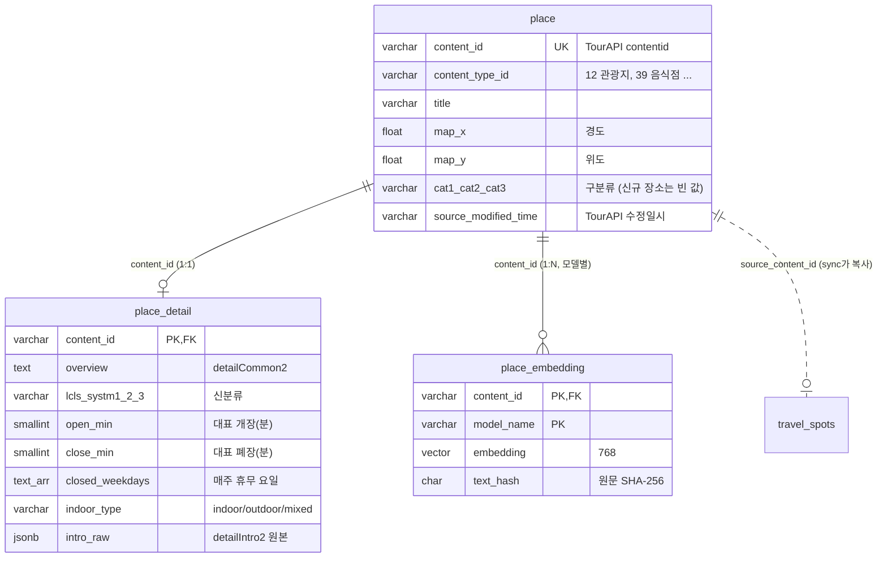

# 장소 데이터 테이블 설계 (PLACE / PLACE_DETAIL / PLACE_EMBEDDING)

> 담당: 김민규 (B-08 수집, B-10 메타데이터 정제, 테이블 설계)
> DDL 원본: [`app/db.py`](../app/db.py) — `init-db`, `enrich`, `sync` 실행 시 `IF NOT EXISTS`로 생성된다.

## 한눈에 보기



| 테이블 | 쓰는 쪽 | 읽는 쪽 | 비고 |
|---|---|---|---|
| `place` | B-08 수집 (`refresh`, `ingest-area`), Kotlin TP_BATCH | 전부 | Kotlin 배치와 **스키마 동일**. 컬럼 추가 금지 |
| `place_gallery_image` | B-08 (`ingest-gallery`) | 화면(F-19 팝업 사진 등) | |
| `place_detail` | B-10 (`enrich`) | C-12 필터, B-11 임베딩 원문, C-13 프롬프트 | **신규** |
| `place_embedding` | B-11 | C-12 벡터 검색 | **신규** — 설계만, 채우는 코드는 B-11 |
| `travel_spots` | `sync` | TP-TRAVEL-AI (현재) | AI 서버 기존 테이블. 아래 '정해야 할 것' 참고 |
| `api_call_quota`, `batch_job_run` | `daily`, 모든 수집 명령 | `status` | 운영용 |
| `fetch_cursor` | 수집 명령 | 수집 명령 | Kotlin과 공유 |

같은 DB에 있는 `region_location`, `short_term_forecast`, `mid_term_forecast` 등은 B-09(날씨)가 쓰는 테이블이다.

## 설계 원칙

1. **`place`는 건드리지 않는다.** Kotlin 배치와 번갈아 돌려도 깨지지 않도록 원본 테이블은 TourAPI 목록 응답 그대로 둔다. 이 배치가 추가로 알아낸 값은 전부 `place_detail`에 둔다. (예전 코드에 있던 `place.overview` 컬럼 추가는 없앴다. 공용 DB에는 원래 반영되지 않았다.)
2. **원문과 정제값을 같이 저장한다.** 운영시간·휴무일은 자유 텍스트라 다 구조화할 수 없다. 정제값(`open_min`, `closed_weekdays` …)은 필터용이고, 원문(`use_time_text`, `rest_date_text`, `intro_raw`)은 LLM(C-13)이 읽는 용도다. 파서를 고치면 `enrich --reparse`로 API 호출 없이 다시 계산한다.
3. **모르면 비워 둔다.** 휴무 요일은 '매주'가 확실할 때만 채운다(`매월 첫째 수요일`은 `closed_irregular=true`로만 표시). 잘못 채우면 멀쩡히 여는 장소가 추천에서 빠진다. 필터는 NULL/불확실을 **통과**시키는 쪽으로 쓴다.
4. **시각은 '자정 기준 분'.** `09:00` → `540`. 자정을 넘기면 1440 이상 (`18:00~02:00` → `1080~1560`). 정수 비교만으로 "이 시각에 열려 있나"를 판단할 수 있다.

## `place_detail` (B-10)

| 컬럼 | 타입 | 설명 |
|---|---|---|
| `content_id` | varchar(20) PK, FK→place | |
| `content_type_id` | varchar(10) | |
| `overview` | text | 개요 (detailCommon2). 임베딩 원문의 본문 |
| `homepage` | text | 태그 제거한 홈페이지 |
| `lcls_systm1/2/3` | varchar(10) | 신분류체계 코드 (예: `NA` / `NA02` / `NA020900` 해수욕장). 신규 장소는 구분류(cat)가 비어 있어 이게 유일한 분류 |
| `ldong_regn_cd`, `ldong_signgu_cd` | varchar(10) | 법정동 시도/시군구 코드 — 날씨 지역 매핑(B-09)용 |
| `use_time_text` | text | 운영시간 원문 (타입별 필드를 한 이름으로: 관광지 `usetime`, 음식점 `opentimefood`, 축제 `playtime` …) |
| `rest_date_text` | text | 휴무일 원문 |
| `parking_text`, `use_fee_text` | text | 주차, 이용요금 원문 |
| `intro_raw` | jsonb | detailIntro2 원본 (빈 값 제외). 대표메뉴(`firstmenu`) 등 기타 필드는 여기서 |
| `open_min`, `close_min` | smallint | 대표 개장·폐장 (분). 평일/주말·계절별 구간을 합친 가장 넓은 범위. 모르면 NULL |
| `always_open` | boolean | '상시 개방', '24시간' |
| `hours_detail` | jsonb | `ranges`(구간별 + 라벨 '평일'/'3월~10월'), `breaks`(준비·휴게시간), `last_order_min` |
| `closed_weekdays` | text[] | 매주 쉬는 요일 `MON`…`SUN` (GIN 인덱스) |
| `closed_on_holidays` | boolean | 공휴일·명절 휴무 |
| `closed_irregular` | boolean | 매주가 아닌 휴무 (`매월 셋째 월요일`, `공휴일인 경우 다음날`) |
| `no_closure` | boolean | 연중무휴 |
| `event_start_date`, `event_end_date` | date | 축제·행사(15) 기간 |
| `indoor_type` | varchar(10) | `indoor` / `outdoor` / `mixed`(시장·테마파크·동굴 등) / NULL |
| `indoor_source` | varchar(20) | 판정 근거: `lcls_systm` > `cat` > `content_type` > `keyword` |
| `parse_status` | varchar(10) | `parsed` / `partial`(운영시간·휴무일 중 하나만) / `unparsed`(원문은 있으나 해석 불가) / `empty`(원문 없음) / `no_data`(API 응답 없음) |
| `source_modified_time` | varchar(20) | 조회 당시 `place.source_modified_time`. 달라지면 다시 조회 |
| `intro_fetched_at`, `common_fetched_at` | timestamptz | 소개정보/공통정보를 받은 시각 |
| `updated_at` | timestamptz | `sync`가 이 값으로 재임베딩 여부를 판단 (`metadata.detail_version`) |

실내외 판정 규칙은 [`app/indoor.py`](../app/indoor.py)에 표로 있다. 실제 장소 49,824건 기준, 신분류 코드 없이도 93.6%가 판정되고 나머지는 `enrich`로 신분류를 받으면 대부분 채워진다.

### C-12에서 쓰는 예

```sql
-- 목요일 14:00(=840분)에 열려 있고, 비 오는 날이면 실내/겸용만.
-- 운영시간을 모르는(NULL) 장소는 빼지 않는다.
SELECT p.content_id, p.title, d.indoor_type, d.use_time_text
FROM place p
JOIN place_detail d ON d.content_id = p.content_id
WHERE NOT ('THU' = ANY (d.closed_weekdays))
  AND (
        d.open_min IS NULL OR d.always_open
     OR (d.open_min <= 840 AND d.close_min > 840)
     OR (d.close_min > 1440 AND d.close_min - 1440 > 840)  -- 전날 밤부터 이어지는 영업
  )
  AND (NOT :is_rainy OR d.indoor_type IN ('indoor', 'mixed'));
```

`travel_spots.metadata`에도 같은 값이 들어간다 (`indoor_type`, `opening_hours{open, close, open_min, close_min, always_open}`, `closed_weekdays`, `closed_on_holidays`, `closed_irregular`, `no_closure`, `use_time_text`, `rest_date_text`, `event_period`).

## `place_embedding` (B-11이 채움)

| 컬럼 | 타입 | 설명 |
|---|---|---|
| `content_id` | varchar(20) PK, FK→place | |
| `model_name` | varchar(100) PK | 예: `jhgan/ko-sroberta-multitask`. 모델 선정(시트의 'LLM/임베딩 모델 선정') 중 두 모델을 나란히 비교할 수 있게 키에 넣었다 |
| `embedding` | vector(768) | HNSW(cosine) 인덱스. **차원은 하나뿐**이라 차원이 다른 모델은 컬럼을 바꾸거나 테이블을 나눠야 한다 |
| `source_text` | text | 임베딩한 원문 (디버깅·재현용) |
| `text_hash` | char(64) | 원문 SHA-256. 같으면 재계산하지 않는다 |
| `created_at`, `updated_at` | timestamptz | |

## 운영 테이블

- `api_call_quota(usage_date, service, calls)` — TourAPI 서비스별 일일 호출 수(KST 기준). 한도(`TOUR_API_DAILY_LIMIT`, 기본 900)에 닿으면 모든 수집 명령이 멈춘다. 같은 서비스키를 Kotlin 배치도 쓰면 이 카운트에는 잡히지 않으니 한도를 여유 있게 둔다.
- `batch_job_run(job, started_at, finished_at, status, stats, error)` — `daily` 실행 이력. `status` 명령에서 최근 5건을 보여 준다.

## 팀에서 정해야 할 것

1. **임베딩을 어디에 둘지 (B-11과 합의).** 지금 AI 서버(TP-TRAVEL-AI)는 `travel_spots`를 읽고, `sync`도 그쪽을 채운다. 시트대로 `place_embedding`으로 옮기면 C-12 검색 쿼리가 `place + place_detail + place_embedding` 조인으로 바뀐다. 테이블은 만들어 두었고, 어느 쪽으로 갈지 정하면 `sync`를 그에 맞게 바꾼다.
2. **지역·카테고리 표기.** AI 서버 샘플 데이터는 `강원도 강릉시`, `자연/바다`인데 배치는 주소 기준 `강원특별자치도 강릉시`, `자연`이다. 실제 주소에는 `전남광주통합특별시` 같은 새 행정구역명도 나온다. 지역 필터는 문자열 비교 대신 `ldong_signgu_cd`나 좌표로 하는 편이 안전하다.
3. **날씨 지역 매핑 키 (B-09와 합의).** `region_location`은 행정동 코드·격자(nx, ny)·중기예보 구역으로 되어 있다. 장소 쪽에서는 `ldong_regn_cd/ldong_signgu_cd`(법정동 시군구)와 위경도를 줄 수 있다. 어느 키로 붙일지 정해야 한다.
4. **삭제된 장소.** 목록 API는 표출 중인 장소만 주므로, TourAPI에서 내려간 장소는 `place`에 남는다(현재 DB 49,824건 vs API 49,634건). 필요하면 `areaBasedSyncList2`의 `showflag`로 정리하는 잡을 추가한다.
